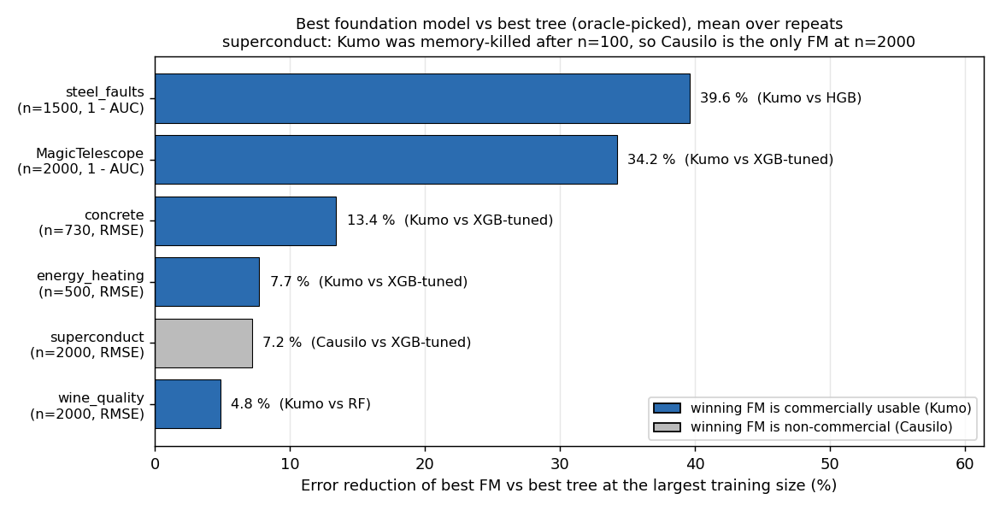
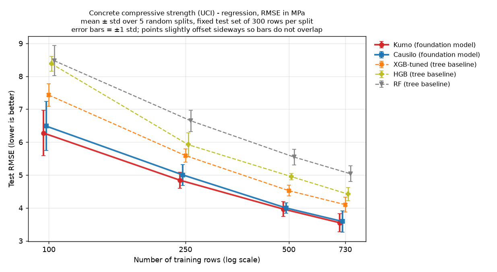
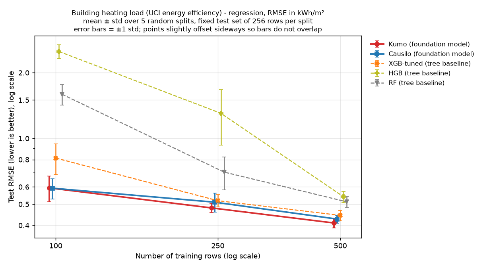
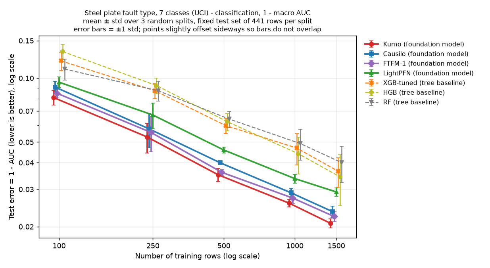
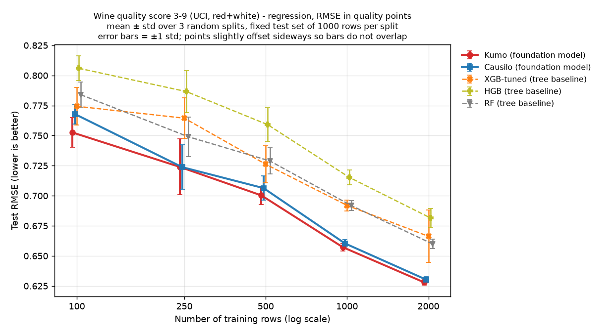
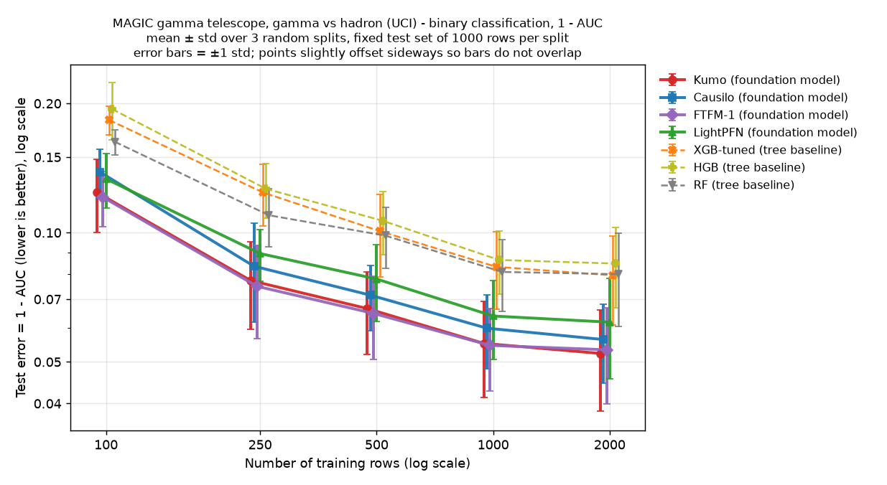
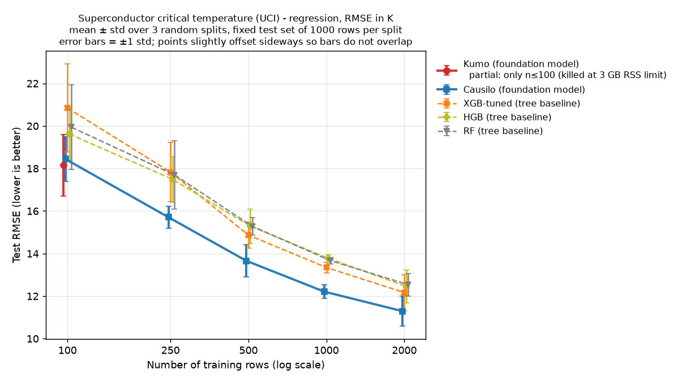

# Tabular foundation models vs tuned trees on small data (CPU, 100 to 2,000 rows)

Updates: [@woongworks on X](https://x.com/woongworks)

A learning-curve benchmark of four tabular foundation models (Kumo-Tabular, Causilo, FTFM-1, LightPFN)
against random forest, HistGradientBoosting and a tuned XGBoost, on six public UCI datasets,
on a 2-core CPU with a 3 GB memory cap.

> Before using model weights or model-generated outputs commercially, check the checkpoint-specific licences.
> In short: FTFM-1 weights are CC BY-NC 4.0, and the public weight licence does not permit commercial use without
> separate permission. Causilo weights are under the non-commercial Causilo License v1.0, which also restricts
> commercial or production use of its outputs. TabPFN-3.5 weights are non-commercial and were **not run** here.
> Kumo-Tabular (OpenMDW-1.1 weights) and LightPFN (Apache-2.0) permit commercial use under their terms.
> Details and sources: [THIRD_PARTY_LICENSES.md](THIRD_PARTY_LICENSES.md).

## Headline

At the largest training size of each dataset, the best foundation model vs the best of the three tree
baselines (mean over repeats). Both the best FM and the best tree were selected using mean test scores.
These are post-hoc comparisons, not estimates of a model-selection procedure on unseen data.

| Dataset | n (train) | Metric | Best FM | Best tree | Difference | Best commercially usable FM |
|---|---|---|---|---|---|---|
| steel_faults (7 classes) | 1,500 | ROC-AUC (macro one-vs-rest) | Kumo 0.9793 | HGB 0.9657 | +0.0136 AUC; 1 − AUC down 39.6 % | Kumo |
| MagicTelescope | 2,000 | ROC-AUC | Kumo 0.9477 | XGB-tuned 0.9205 | +0.0272 AUC; 1 − AUC down 34.2 % | Kumo |
| concrete | 730 | RMSE (MPa) | Kumo 3.550 | XGB-tuned 4.100 | RMSE down 13.4 % | Kumo |
| energy_heating | 500 | RMSE | Kumo 0.410 | XGB-tuned 0.444 | RMSE down 7.7 % | Kumo |
| superconduct | 2,000 | RMSE (K) | Causilo 11.29 (**non-commercial**) | XGB-tuned 12.17 | RMSE down 7.2 % | none at this size: Kumo hit the memory cap after n = 100 |
| wine_quality | 2,000 | RMSE | Kumo 0.628 | RF 0.660 | RMSE down 4.8 % | Kumo |

For the two classification sets, the percentage is the drop in 1 − AUC, not in misclassification rate.
Per-repeat AUC differences at the largest size (Kumo minus the best tree on the same split):
steel_faults +0.0047, +0.0150, +0.0200; MagicTelescope +0.0216, +0.0312, +0.0281.



- On every dataset and at every training size, the best FM had a better mean score than the best of the three trees.
  The comparison is only against RF, HGB and a 20-config XGBoost search; CatBoost and LightGBM were not run.
- **Data efficiency (interpolated estimate, not a measured run):** for each tree training size, we estimated by
  log-n interpolation of the FM's mean learning curve how many rows the FM needed to reach the best tree's score.
  The median tree/FM training-row ratio was 1.97, i.e. the FM needed an estimated ~51 % of the rows
  (20 points, range 1.36 to 8.76). How the 20 points were chosen is under *Method*.
- The top ratio, 8.76 on MagicTelescope, is FTFM-1 (non-commercial weights) at an estimated ~228 rows.
  FTFM reports known benchmark overlap from pretraining; whether either classification dataset used here is
  affected remains unverified. Kumo's estimate on the same dataset is ~240 rows (ratio 8.35).
- **Cost:** timing depends on the implementation: Kumo and Causilo spent most of their time in prediction,
  while FTFM-1 took 158 s to fit on steel_faults (n = 1,500, mean per split). At n = 2,000, Kumo predicted the
  1,000 test rows in 63 to 86 s and Causilo in 15 to 64 s; tree prediction took at most 0.13 s for the same rows.
  Kumo used 2.4 to 3.0 GB RSS. These are single-machine observations on 2 cores.
- **superconduct is partial for Kumo:** Kumo was killed by the 3 GB RSS guard (peak 3,025 MB) during n = 250
  on this 81-feature dataset, so it only has n = 100. All other models are complete.

Full numbers, per-dataset tables, paired win counts and timings are in [REPORT.md](REPORT.md)
(Korean version: [REPORT_KO.md](REPORT_KO.md)).

## Learning curves

| | |
|---|---|
|  |  |
|  |  |
|  |  |

## Method (short)

- **Data:** six UCI datasets, CC BY 4.0, prepared as described in [data/README.md](data/README.md):
  concrete (1,030 rows); energy_heating (768; target heating load, the cooling-load column is dropped);
  steel_faults (1,941; the 7 one-hot fault columns are merged into one 7-class target `fault_type` and not used
  as inputs); wine_quality (6,497; red and white combined, with an `is_red` input column); MagicTelescope (19,020, binary);
  superconduct (21,263, 81 features, `train.csv` only).
- **Metrics:** RMSE for regression. ROC-AUC for classification: binary AUC for MagicTelescope, macro-averaged
  one-vs-rest AUC for the 7-class steel_faults (`sklearn.metrics.roc_auc_score`).
- **Splits:** for repeat r the seed is 0 + r. One test set is drawn per repeat (stratified for classification) and
  shared by every training size and every model in that repeat. The training set for each size is drawn from the
  remaining rows with seed `seed + 1000·n` (also stratified for classification; at concrete n = 730 the whole remaining pool is used). Repeats / test rows: concrete 5 / 300, energy_heating 5 / 256
  (268 requested, capped at N/3), steel_faults 3 / 441, the other three 3 / 1,000.
- **Win counts:** "15/15" counts size-by-repeat comparisons (e.g. 5 sizes × 3 repeats), FM vs the best of the three
  trees on the same split. Within a repeat the test set is reused across sizes, so these are not 15 independent
  splits: there are only 3 (or 5) distinct test sets per dataset.
- **Trees:** RF with 500 trees, HGB with sklearn defaults, XGBoost (`tree_method=hist`) with `RandomizedSearchCV`:
  20 configurations, 3-fold CV on the training rows only (stratified for classification, shuffled,
  `random_state=seed`), scoring `neg_log_loss` / `neg_root_mean_squared_error`, then refit on all training rows.
  Search space: `n_estimators` 100–999, `learning_rate` 0.01–0.3 (log), `max_depth` 2–8, `subsample` 0.6–1.0,
  `colsample_bytree` 0.5–1.0, `min_child_weight` 1–10 (log), `reg_lambda` 0.1–10 (log). See `bench_tabular.py`.
- **FMs:** package defaults, no tuning (Kumo and Causilo with 4 estimators). Kumo regression uses the mean of its
  999 predicted quantiles. FTFM-1 and LightPFN are classification-only (FTFM-1 regression weights are not released).
- **Timing:** `fit_s` is measured from model construction to the end of `fit`, so it includes building the model
  object and, for the FMs, loading weights from the local cache. For XGB-tuned it includes the whole
  20 × 3-fold search plus the refit (66 s on superconduct at n = 2,000). `predict_s` covers prediction of the whole
  test set in batches of 500 rows. Each split builds a fresh model inside one worker process per model.
- **Hardware budget:** CPU only, `taskset` to 2 cores, `nice -n 10`, 2 threads, a watchdog that kills any
  worker above 3,000 MB RSS, and a wall-clock timeout per model. The machine was shared with other jobs.
- **Data-efficiency points (`make_headline.py`):** per dataset, the FM is the one with the best average rank on
  test across sizes, among FMs with a complete learning curve. For every measured tree size n_t, the target is the
  best tree's mean test score at n_t. The FM's row count is found by linear interpolation in log n between the
  first measured FM size that reaches the target and the size before it. No extrapolation: if the FM already beats
  the target at its smallest size (100 rows), only a lower bound is known and the point is excluded; a target the
  FM never reaches would also be excluded (none occurred). That leaves 20 of 27 points (excluded: n_t = 100 on all
  six datasets and n_t = 250 on steel_faults). Interpolation uses the mean curve as measured, without smoothing.

## Limitations

- Six small, mostly numeric public datasets (≤ 81 features, ≤ 2,000 training rows). No categorical-heavy,
  high-cardinality, time-dependent or large-n data.
- Pretraining overlap was not checked for any FM. FTFM's model card states that its name-based filter against
  benchmark tables missed a small number of tables; which tables is not stated, so overlap with MagicTelescope
  or steel_faults is unverified either way.
- 3 to 5 repeats, no formal significance tests. Win counts are size-by-repeat comparisons on shared test sets.
- The conclusions are limited to the three tree baselines tested: a 20-config XGBoost search, RF and HGB.
  No CatBoost or LightGBM, no feature engineering.
- Post-hoc selection on both sides: the best tree and the best FM are picked on mean test scores.
- All timings are observed on one shared machine with 2 CPU cores and a 3 GB cap; they are not a controlled speed
  benchmark. Kumo's superconduct failure is specific to that cap. Large screening workloads were not tested.

## Repository layout

```
bench_tabular.py        benchmark harness (one subprocess per model, RSS watchdog, timeouts)
make_tables.py          results/*.json -> results/tables.md
make_headline.py        data-efficiency ratios -> results/headline.{md,json}
make_charts.py          learning-curve PNGs
make_summary_chart.py   charts/summary_gain_largest_n.png
run_all.sh              full re-run with the published settings
data/                   the six datasets (CC BY 4.0) + citations
results/                per-dataset JSON, summary and raw CSVs, tables, headline
charts/                 PNGs used above
env/                    full package lists of the venvs used for the published run
REPORT.md, REPORT_KO.md full write-up (English, Korean)
```

## Reproduce

Re-draw tables and charts from the shipped results (needs pandas and matplotlib):

```bash
NAMES="concrete energy_heating steel_faults wine_quality MagicTelescope superconduct"
python3 make_tables.py $NAMES > results/tables.md
python3 make_headline.py $NAMES > results/headline.md
python3 make_charts.py $NAMES
python3 make_summary_chart.py
```

Full re-run: create one virtualenv per model under `venvs/` (or point `BENCH_VENVS` elsewhere, or set
`BENCH_PY_<MODEL>=/path/to/python` per model):

| venv | install |
|---|---|
| `venvs/trees` | `pip install -r requirements-trees.txt` |
| `venvs/kumo` | NVIDIA `structured-data-models` 0.2.1 (module `sdm`) |
| `venvs/causilo` | `causilo==1.0.3` |
| `venvs/ftfm` | `ftfm` 0.1.0 from `git+https://github.com/machinelearningnuremberg/ftfm-official.git@7e5e237d` |
| `venvs/lightpfn` | `LightPFN==1.1.0` |
| `venvs/tabpfn` | `tabpfn==9.2.0` (optional; needs a Prior Labs account and `TABPFN_TOKEN`) |

All FM venvs used Python 3.12.15, torch 2.15.0+cpu, numpy 2.5.4 and scikit-learn 1.9.1. The complete package
list of every venv used for the published run is in [env/](env/) (`env/<venv>.txt`). Checkpoint revisions are
listed in [THIRD_PARTY_LICENSES.md](THIRD_PARTY_LICENSES.md). Then run `./run_all.sh`
(set `CORES=0,1` or similar for your machine). A model whose venv is missing is recorded as unavailable
and the run continues. The per-model wall times recorded in `results/*.json` add up to about 1.8 hours on 2 cores.

## Licence

Code, results and charts in this repository: MIT ([LICENSE](LICENSE)). Datasets: CC BY 4.0 (UCI).
Models keep their own licences, see [THIRD_PARTY_LICENSES.md](THIRD_PARTY_LICENSES.md). Before using model weights
or model-generated outputs commercially, check the checkpoint-specific licences.
