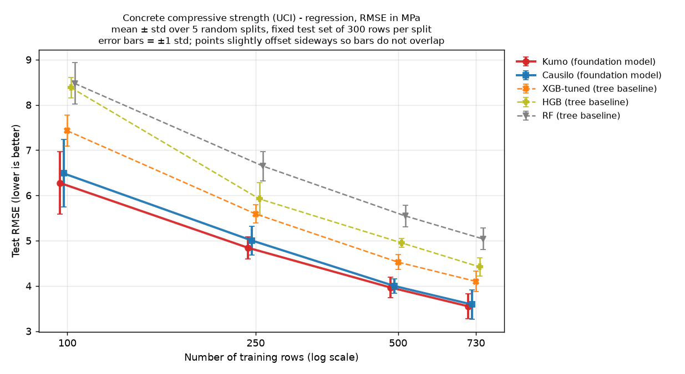
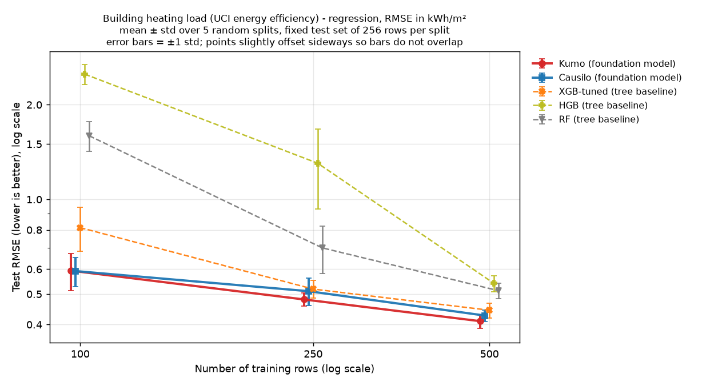
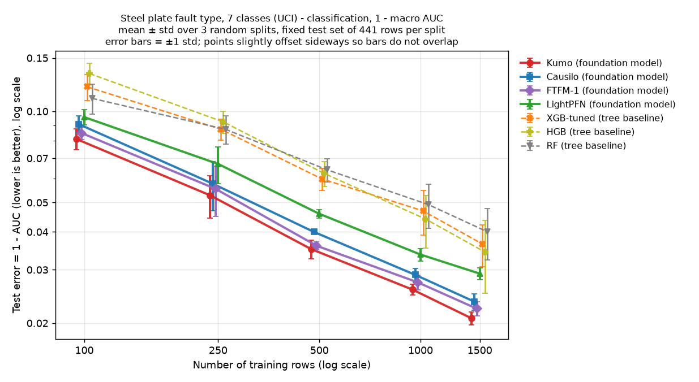
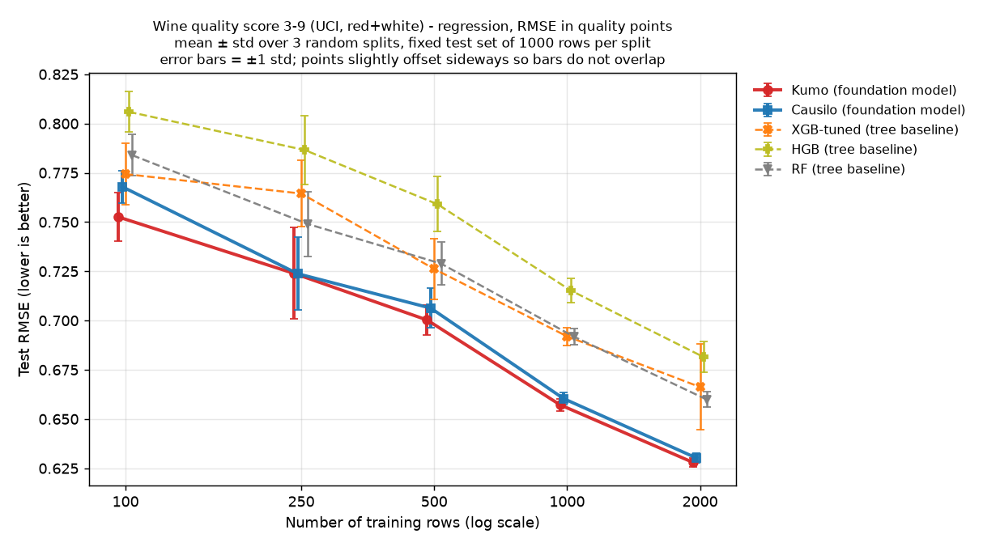
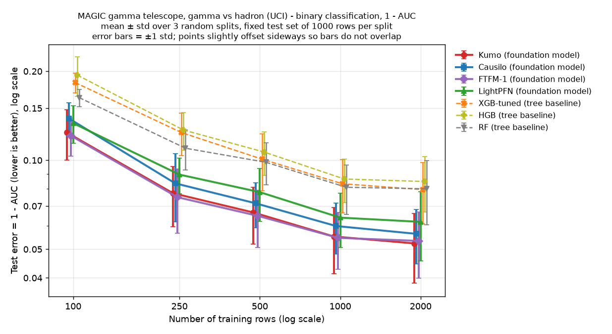
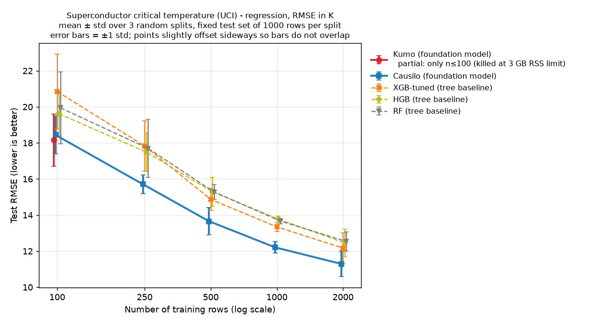

# Small tabular foundation models vs tuned tree baselines — learning-curve PoC

*Generated 2026-11-02 (KST) from `results/*.json` / `results/*_summary.csv` / `results/*_raw.csv`. Every number below is copied or directly derived (ratios, paired win counts) from those files.*

## TL;DR

- **Six public UCI datasets, 100 – 2,000 training rows.** On every dataset and at every training size, the best foundation model (FM) had a better mean test score than the best of the three tree baselines (RF, HGB, XGB-tuned). Both the best FM and the best tree were selected using mean test scores. These are post-hoc comparisons, not estimates of a model-selection procedure on unseen data.
- **Size of the gain at the largest training size:** concrete −13.4 % RMSE, energy_heating −7.7 % RMSE, wine_quality −4.8 % RMSE, superconduct −7.2 % RMSE; steel_faults −39.6 % and MagicTelescope −34.2 % in (1 − AUC), i.e. +0.0136 and +0.0272 AUC.
- **Data efficiency.** Log-n interpolation estimates (not measured runs): the FM with the best average rank on test reached the best tree's score with a median tree/FM row ratio of **1.97** (the FM needed an estimated ~51 % of the rows; 20 interpolated points; range 1.36 – 8.76). FTFM reports known benchmark overlap from pretraining; whether either classification dataset used here is affected remains unverified. Per dataset at the largest size: concrete 1.62×, energy_heating 1.40×, steel_faults 2.83×, wine_quality 2.09×, MagicTelescope 8.76×, superconduct 1.94×.
- **Kumo (NVIDIA)** had the best mean at the largest size on 5 of 6 datasets. The exception is superconduct, where Kumo was memory-killed and **Causilo** had the only full FM curve. **FTFM-1** was best on MagicTelescope at n ≤ 1000.
- **Cost:** the FMs are much slower at prediction time and use more memory on CPU. Kumo used 2.4 – 3.0 GB RSS and was **killed at the 3 GB limit on superconduct (81 features) after n = 100**. Timing depends on the implementation: Kumo and Causilo spent most of their time in prediction, while FTFM-1 took 158 s to fit on steel_faults (n = 1500, mean per split).
- **Licences matter more than accuracy here.** FTFM-1 weights are **CC BY-NC 4.0**, Causilo weights are under a **non-commercial "Causilo License v1.0"**, and TabPFN-3.5 weights are non-commercial. TabPFN was not run because it needs a licence/account. Kumo (OpenMDW-1.1 weights, Apache-2.0 code) and LightPFN (Apache-2.0, classification-only) permit commercial use under their terms. Before using model weights or model-generated outputs commercially, check the checkpoint-specific licences.

## 1. Method

| Item | Setting |
|---|---|
| Harness | `bench_tabular.py`. Each model runs in its own venv as a worker subprocess; an orchestrator records status, wall time, and peak RSS |
| Splits | For each repeat r (seed = r), one test set is drawn (stratified for classification). Training sets of each size n are then drawn from the remaining pool (stratified for cls). Within a repeat, all models and sizes share the same test set and all models share the same training rows |
| Repeats / test size | concrete 5 reps, test 300 · energy_heating 5 reps, test 256 (requested 268, capped at N/3) · steel_faults 3 reps, test 441 · wine_quality, MagicTelescope, superconduct 3 reps, test 1000 |
| Training sizes | 100, 250, 500, plus 730 (concrete) / – (energy_heating) / 1000, 1500 (steel_faults) / 1000, 2000 (others) |
| Preprocessing | Non-numeric features ordinal-encoded. Missing features filled with the training-split median. Rows with missing target dropped |
| Metrics | Regression: RMSE (also MAE, R² in raw files). Classification: ROC-AUC (binary, or macro one-vs-rest for steel_faults' 7 classes), with accuracy and log-loss in the raw files. Tables show mean ± std over repeats. The std includes test-set variation because each repeat draws a new test set |
| Tree baselines | RF: 500 trees. HGB: sklearn defaults. XGB-tuned: randomized search, 20 configs, 3-fold CV on the training rows only (log-loss / RMSE) |
| FMs (package defaults, no tuning) | Kumo-Tabular (NVIDIA `structured-data-models` 0.2.1, 4 estimators; regression = mean of 999 predicted quantiles). Causilo 1.0.3 (4 estimators). FTFM-1 0.1.0 (classification only; regression weights unreleased). LightPFN 1.1.0 (classification only). TabPFN 9.2.0 (attempted) |
| "Best tree" / "best FM" | Both chosen on mean test scores (post hoc). The comparison is not an estimate of a model-selection procedure on unseen data |
| CPU / memory limits | `taskset -c 2,3` (2 of 8 cores), `nice -n 10`, 2 threads (OMP/MKL/OpenBLAS), RSS watchdog killing any worker above 3000 MB, wall-clock timeout 3600 s (3000 s for wine_quality / MagicTelescope / superconduct). CPU only, no GPU |
| Data-efficiency ratio | For tree size n_t: n_t ÷ (rows the FM needs to reach the best tree's score at n_t), by log-linear interpolation of the FM's mean curve (`make_headline.py`, using the FM with the best average rank among those with a complete curve) |
| Paired wins | Per (size, repeat) comparison: does the FM beat the best of the three trees **on that same split**? The test set is shared across sizes within a repeat, so e.g. 15 comparisons use only 3 distinct test sets and are not independent |

## 2. Datasets and run status

| Dataset | Rows | Features | Task | Status |
|---|---|---|---|---|
| concrete | 1,030 | 8 | regression (MPa) | complete |
| energy_heating | 768 | 8 | regression (kWh/m²) | complete |
| steel_faults | 1,941 | 27 | 7-class classification | complete |
| wine_quality | 6,497 | 12 | regression (quality points) | complete |
| MagicTelescope | 19,020 | 10 | binary classification | complete |
| superconduct | 21,263 | 81 | regression (K) | **partial**: Kumo killed by the 3 GB RSS guard (peak 3,025 MB) during n = 250, so Kumo has n = 100 only. All other models are complete |

Model availability across all datasets:
- **TabPFN:** unavailable everywhere (`TabPFNLicenseError`: weights need a one-time licence acceptance with a Prior Labs account).
- **FTFM-1:** unavailable on the 4 regression sets (`FTFMRegressor is not yet implemented: regression weights have not been released`).
- **LightPFN:** skipped on regression (classification-only).

## 3. Per-dataset results

Bold = best mean at that size. Below each table, "FM vs tree" compares the best FM with the best tree at each size (negative = FM better). Charts: `charts/learning_curve_<name>.png`.

#### concrete  (1030 rows, 8 features, reg, test 300 rows, 5 repeats; metric RMSE mean ± std)

| Model | n=100 | n=250 | n=500 | n=730 |
|---|---|---|---|---|
| Kumo | **6.277 ± 0.693** | **4.842 ± 0.240** | **3.965 ± 0.225** | **3.550 ± 0.272** |
| Causilo | 6.487 ± 0.747 | 5.003 ± 0.315 | 3.998 ± 0.158 | 3.589 ± 0.322 |
| XGB-tuned (tree) | 7.428 ± 0.342 | 5.591 ± 0.201 | 4.525 ± 0.166 | 4.100 ± 0.228 |
| HGB (tree) | 8.381 ± 0.223 | 5.924 ± 0.363 | 4.950 ± 0.103 | 4.421 ± 0.202 |
| RF (tree) | 8.475 ± 0.459 | 6.648 ± 0.324 | 5.546 ± 0.236 | 5.038 ± 0.239 |

| n | best FM | best tree | FM vs tree |
|---|---|---|---|
| 100 | Kumo 6.277 | XGB-tuned 7.428 | -15.5 % RMSE |
| 250 | Kumo 4.842 | XGB-tuned 5.591 | -13.4 % RMSE |
| 500 | Kumo 3.965 | XGB-tuned 4.525 | -12.4 % RMSE |
| 730 | Kumo 3.55 | XGB-tuned 4.1 | -13.4 % RMSE |

Data efficiency (rows the FM needs to match the best tree at the largest size; log-interpolated):

- Causilo: tree XGB-tuned at n=730 scores 4.1; FM matches at n≈466.1 → ratio 1.57  
- Kumo: tree XGB-tuned at n=730 scores 4.1; FM matches at n≈449.4 → ratio 1.62  

Model status: RF: finished; HGB: finished; XGB-tuned: finished; Causilo: finished; LightPFN: skipped [classification-only model]; FTFM-1: unavailable (NotImplementedError: FTFMRegressor is not yet implemented: regression weights have not bee); Kumo: finished; TabPFN: unavailable (TabPFNLicenseError: TabPFN requires a one-time license acceptance to download)

Paired: Kumo and Causilo each beat the best tree on 20/20 splits.

#### energy_heating  (768 rows, 8 features, reg, test 256 rows, 5 repeats; metric RMSE mean ± std)

| Model | n=100 | n=250 | n=500 |
|---|---|---|---|
| Kumo | 0.593 ± 0.080 | **0.481 ± 0.023** | **0.410 ± 0.021** |
| Causilo | **0.592 ± 0.063** | 0.511 ± 0.050 | 0.427 ± 0.018 |
| XGB-tuned (tree) | 0.813 ± 0.130 | 0.519 ± 0.033 | 0.444 ± 0.024 |
| HGB (tree) | 2.502 ± 0.184 | 1.303 ± 0.372 | 0.541 ± 0.032 |
| RF (tree) | 1.593 ± 0.174 | 0.701 ± 0.120 | 0.513 ± 0.029 |

| n | best FM | best tree | FM vs tree |
|---|---|---|---|
| 100 | Causilo 0.5916 | XGB-tuned 0.8131 | -27.2 % RMSE |
| 250 | Kumo 0.4807 | XGB-tuned 0.5186 | -7.3 % RMSE |
| 500 | Kumo 0.41 | XGB-tuned 0.4442 | -7.7 % RMSE |

Data efficiency (rows the FM needs to match the best tree at the largest size; log-interpolated):

- Causilo: tree XGB-tuned at n=500 scores 0.4442; FM matches at n≈434.1 → ratio 1.15  
- Kumo: tree XGB-tuned at n=500 scores 0.4442; FM matches at n≈357.5 → ratio 1.4  

Model status: RF: finished; HGB: finished; XGB-tuned: finished; Causilo: finished; LightPFN: skipped [classification-only model]; FTFM-1: unavailable (NotImplementedError: FTFMRegressor is not yet implemented: regression weights have not bee); Kumo: finished; TabPFN: unavailable (TabPFNLicenseError: TabPFN requires a one-time license acceptance to download)

Paired: Kumo beat the best tree on 14/15 splits and Causilo on 11/15. At n = 100, Kumo (0.593) and Causilo (0.592) are effectively tied. This is the weakest FM result: XGB-tuned is within 7–8 % at n ≥ 250, and HGB is unusually poor at small n.

#### steel_faults  (1941 rows, 27 features, cls, test 441 rows, 3 repeats; metric AUC mean ± std)

| Model | n=100 | n=250 | n=500 | n=1000 | n=1500 |
|---|---|---|---|---|---|
| Kumo | **0.9189 ± 0.0065** | **0.9472 ± 0.0084** | **0.9649 ± 0.0024** | **0.9742 ± 0.0010** | **0.9793 ± 0.0010** |
| Causilo | 0.9094 ± 0.0059 | 0.9423 ± 0.0107 | 0.9600 ± 0.0003 | 0.9711 ± 0.0015 | 0.9765 ± 0.0015 |
| FTFM-1 | 0.9152 ± 0.0041 | 0.9445 ± 0.0106 | 0.9640 ± 0.0011 | 0.9727 ± 0.0015 | 0.9777 ± 0.0012 |
| LightPFN | 0.9043 ± 0.0057 | 0.9330 ± 0.0092 | 0.9541 ± 0.0015 | 0.9663 ± 0.0016 | 0.9709 ± 0.0013 |
| XGB-tuned (tree) | 0.8794 ± 0.0119 | 0.9127 ± 0.0069 | 0.9402 ± 0.0049 | 0.9531 ± 0.0079 | 0.9635 ± 0.0057 |
| HGB (tree) | 0.8668 ± 0.0107 | 0.9077 ± 0.0079 | 0.9377 ± 0.0058 | 0.9559 ± 0.0087 | 0.9657 ± 0.0093 |
| RF (tree) | 0.8896 ± 0.0126 | 0.9128 ± 0.0094 | 0.9359 ± 0.0056 | 0.9508 ± 0.0082 | 0.9600 ± 0.0077 |

| n | best FM | best tree | FM vs tree |
|---|---|---|---|
| 100 | Kumo 0.9189 | RF 0.8896 | -26.5 % (1−AUC) |
| 250 | Kumo 0.9472 | RF 0.9128 | -39.4 % (1−AUC) |
| 500 | Kumo 0.9649 | XGB-tuned 0.9402 | -41.4 % (1−AUC) |
| 1000 | Kumo 0.9742 | HGB 0.9559 | -41.5 % (1−AUC) |
| 1500 | Kumo 0.9793 | HGB 0.9657 | -39.6 % (1−AUC) |

Data efficiency (rows the FM needs to match the best tree at the largest size; log-interpolated):

- Causilo: tree HGB at n=1500 scores 0.9657; FM matches at n≈711.3 → ratio 2.11  
- FTFM-1: tree HGB at n=1500 scores 0.9657; FM matches at n≈570.4 → ratio 2.63  
- Kumo: tree HGB at n=1500 scores 0.9657; FM matches at n≈529.3 → ratio 2.83  
- LightPFN: tree HGB at n=1500 scores 0.9657; FM matches at n≈963.3 → ratio 1.56  

Model status: RF: finished; HGB: finished; XGB-tuned: finished; Causilo: finished; LightPFN: finished; FTFM-1: finished; Kumo: finished; TabPFN: unavailable (TabPFNLicenseError: TabPFN requires a one-time license acceptance to download)

Paired: Kumo, Causilo, and FTFM-1 15/15; LightPFN 14/15.

#### wine_quality  (6497 rows, 12 features, reg, test 1000 rows, 3 repeats; metric RMSE mean ± std)

| Model | n=100 | n=250 | n=500 | n=1000 | n=2000 |
|---|---|---|---|---|---|
| Kumo | **0.753 ± 0.012** | 0.724 ± 0.023 | **0.700 ± 0.007** | **0.657 ± 0.003** | **0.628 ± 0.002** |
| Causilo | 0.768 ± 0.008 | **0.724 ± 0.018** | 0.706 ± 0.010 | 0.660 ± 0.003 | 0.630 ± 0.002 |
| XGB-tuned (tree) | 0.774 ± 0.016 | 0.764 ± 0.017 | 0.726 ± 0.015 | 0.692 ± 0.005 | 0.666 ± 0.022 |
| HGB (tree) | 0.806 ± 0.010 | 0.787 ± 0.017 | 0.759 ± 0.014 | 0.715 ± 0.006 | 0.682 ± 0.008 |
| RF (tree) | 0.784 ± 0.011 | 0.749 ± 0.016 | 0.729 ± 0.011 | 0.692 ± 0.004 | 0.660 ± 0.004 |

| n | best FM | best tree | FM vs tree |
|---|---|---|---|
| 100 | Kumo 0.7526 | XGB-tuned 0.7743 | -2.8 % RMSE |
| 250 | Causilo 0.7238 | RF 0.749 | -3.4 % RMSE |
| 500 | Kumo 0.7003 | XGB-tuned 0.7262 | -3.6 % RMSE |
| 1000 | Kumo 0.6572 | RF 0.6918 | -5.0 % RMSE |
| 2000 | Kumo 0.628 | RF 0.6599 | -4.8 % RMSE |

Data efficiency (rows the FM needs to match the best tree at the largest size; log-interpolated):

- Causilo: tree RF at n=2000 scores 0.6599; FM matches at n≈1011.0 → ratio 1.98  
- Kumo: tree RF at n=2000 scores 0.6599; FM matches at n≈958.0 → ratio 2.09  

Model status: RF: finished; HGB: finished; XGB-tuned: finished; Causilo: finished; LightPFN: skipped [classification-only model]; FTFM-1: unavailable (NotImplementedError: FTFMRegressor is not yet implemented: regression weights have not bee); Kumo: finished; TabPFN: unavailable (TabPFNLicenseError: TabPFN requires a one-time license acceptance to download)

Paired: Kumo 15/15, Causilo 14/15. Gains are small (2.8 – 5.0 % RMSE), but they are consistent.

#### MagicTelescope  (19020 rows, 10 features, cls, test 1000 rows, 3 repeats; metric AUC mean ± std)

| Model | n=100 | n=250 | n=500 | n=1000 | n=2000 |
|---|---|---|---|---|---|
| Kumo | 0.8758 ± 0.0241 | 0.9226 ± 0.0178 | 0.9334 ± 0.0145 | 0.9448 ± 0.0139 | **0.9477 ± 0.0139** |
| Causilo | 0.8615 ± 0.0181 | 0.9165 ± 0.0217 | 0.9285 ± 0.0125 | 0.9401 ± 0.0117 | 0.9436 ± 0.0117 |
| FTFM-1 | **0.8791 ± 0.0177** | **0.9250 ± 0.0184** | **0.9352 ± 0.0143** | **0.9454 ± 0.0119** | 0.9466 ± 0.0135 |
| LightPFN | 0.8665 ± 0.0192 | 0.9106 ± 0.0124 | 0.9220 ± 0.0158 | 0.9360 ± 0.0134 | 0.9381 ± 0.0162 |
| XGB-tuned (tree) | 0.8169 ± 0.0143 | 0.8759 ± 0.0205 | 0.8991 ± 0.0220 | 0.9167 ± 0.0171 | 0.9205 ± 0.0186 |
| HGB (tree) | 0.8059 ± 0.0298 | 0.8735 ± 0.0183 | 0.8934 ± 0.0179 | 0.9136 ± 0.0145 | 0.9153 ± 0.0179 |
| RF (tree) | 0.8372 ± 0.0109 | 0.8902 ± 0.0170 | 0.9016 ± 0.0159 | 0.9190 ± 0.0153 | 0.9200 ± 0.0196 |

| n | best FM | best tree | FM vs tree |
|---|---|---|---|
| 100 | FTFM-1 0.8791 | RF 0.8372 | -25.7 % (1−AUC) |
| 250 | FTFM-1 0.925 | RF 0.8902 | -31.7 % (1−AUC) |
| 500 | FTFM-1 0.9352 | RF 0.9016 | -34.1 % (1−AUC) |
| 1000 | FTFM-1 0.9454 | RF 0.919 | -32.6 % (1−AUC) |
| 2000 | Kumo 0.9477 | XGB-tuned 0.9205 | -34.2 % (1−AUC) |

Data efficiency (rows the FM needs to match the best tree at the largest size; log-interpolated):

- Causilo: tree XGB-tuned at n=2000 scores 0.9205; FM matches at n≈315.1 → ratio 6.35  
- FTFM-1: tree XGB-tuned at n=2000 scores 0.9205; FM matches at n≈228.4 → ratio 8.76  
- Kumo: tree XGB-tuned at n=2000 scores 0.9205; FM matches at n≈239.6 → ratio 8.35  
- LightPFN: tree XGB-tuned at n=2000 scores 0.9205; FM matches at n≈455.5 → ratio 4.39  

Model status: RF: finished; HGB: finished; XGB-tuned: finished; Causilo: finished; LightPFN: finished; FTFM-1: finished; Kumo: finished; TabPFN: unavailable (TabPFNLicenseError: TabPFN requires a one-time license acceptance to download)

Paired: all four FMs beat the best tree on 15/15 size-by-repeat comparisons (3 distinct test sets). The error bars overlap visually because each repeat uses a different test set; within each comparison the ordering held every time.

#### superconduct  (21263 rows, 81 features, reg, test 1000 rows, 3 repeats; metric RMSE mean ± std)

| Model | n=100 | n=250 | n=500 | n=1000 | n=2000 |
|---|---|---|---|---|---|
| Kumo | **18.152 ± 1.445** | – | – | – | – |
| Causilo | 18.445 ± 1.054 | **15.708 ± 0.509** | **13.657 ± 0.763** | **12.208 ± 0.314** | **11.294 ± 0.697** |
| XGB-tuned (tree) | 20.845 ± 2.069 | 17.830 ± 1.401 | 14.867 ± 0.605 | 13.345 ± 0.250 | 12.167 ± 0.849 |
| HGB (tree) | 19.617 ± 1.235 | 17.492 ± 1.077 | 15.289 ± 0.808 | 13.776 ± 0.171 | 12.453 ± 0.774 |
| RF (tree) | 19.938 ± 1.997 | 17.698 ± 1.597 | 15.279 ± 0.420 | 13.670 ± 0.145 | 12.534 ± 0.532 |

| n | best FM | best tree | FM vs tree |
|---|---|---|---|
| 100 | Kumo 18.15 | HGB 19.62 | -7.5 % RMSE |
| 250 | Causilo 15.71 | HGB 17.49 | -10.2 % RMSE |
| 500 | Causilo 13.66 | XGB-tuned 14.87 | -8.1 % RMSE |
| 1000 | Causilo 12.21 | XGB-tuned 13.34 | -8.5 % RMSE |
| 2000 | Causilo 11.29 | XGB-tuned 12.17 | -7.2 % RMSE |

Data efficiency (rows the FM needs to match the best tree at the largest size; log-interpolated):

- Causilo: tree XGB-tuned at n=2000 scores 12.17; FM matches at n≈1032.1 → ratio 1.94  
- Kumo: tree HGB at n=100 scores 19.62; FM matches at n≈100.0 → ratio 1.0  FM already matches at the smallest size measured (100); ratio is a lower bound

Model status: RF: finished; HGB: finished; XGB-tuned: finished; Causilo: finished; LightPFN: skipped [classification-only model]; FTFM-1: unavailable (NotImplementedError: FTFMRegressor is not yet implemented: regression weights have not bee); Kumo: failed [killed: RSS 3025 MB > limit 3000 MB]; TabPFN: unavailable (TabPFNLicenseError: TabPFN requires a one-time license acceptance to download)

Paired: Causilo 15/15; Kumo 3/3 (n = 100 only). Kumo's data-efficiency entry above (ratio 1.0) is an artefact of having only one size and should be ignored.

## 4. Data efficiency (headline)

Output of `make_headline.py` (`results/headline.md`, `results/headline.json`):

| Dataset | Best FM | tree size n_t | best tree (score) | FM rows to match | data ratio |
|---|---|---|---|---|---|
| concrete | Kumo | 100 | XGB-tuned (7.428) | ≤ 100 | ≥ 1.00× |
| concrete | Kumo | 250 | XGB-tuned (5.591) | 155 | 1.61× |
| concrete | Kumo | 500 | XGB-tuned (4.525) | 321 | 1.56× |
| concrete | Kumo | 730 | XGB-tuned (4.1) | 449 | 1.62× |
| energy_heating | Kumo | 100 | XGB-tuned (0.8131) | ≤ 100 | ≥ 1.00× |
| energy_heating | Kumo | 250 | XGB-tuned (0.5186) | 184 | 1.36× |
| energy_heating | Kumo | 500 | XGB-tuned (0.4442) | 358 | 1.40× |
| steel_faults | Kumo | 100 | RF (0.8896) | ≤ 100 | ≥ 1.00× |
| steel_faults | Kumo | 250 | RF (0.9128) | ≤ 100 | ≥ 2.50× |
| steel_faults | Kumo | 500 | XGB-tuned (0.9402) | 199 | 2.51× |
| steel_faults | Kumo | 1000 | HGB (0.9559) | 352 | 2.84× |
| steel_faults | Kumo | 1500 | HGB (0.9657) | 529 | 2.83× |
| wine_quality | Kumo | 100 | XGB-tuned (0.7743) | ≤ 100 | ≥ 1.00× |
| wine_quality | Kumo | 250 | RF (0.749) | 112 | 2.23× |
| wine_quality | Kumo | 500 | XGB-tuned (0.7262) | 232 | 2.15× |
| wine_quality | Kumo | 1000 | RF (0.6918) | 573 | 1.75× |
| wine_quality | Kumo | 2000 | RF (0.6599) | 958 | 2.09× |
| MagicTelescope | FTFM-1 | 100 | RF (0.8372) | ≤ 100 | ≥ 1.00× |
| MagicTelescope | FTFM-1 | 250 | RF (0.8902) | 125 | 2.00× |
| MagicTelescope | FTFM-1 | 500 | RF (0.9016) | 157 | 3.19× |
| MagicTelescope | FTFM-1 | 1000 | RF (0.919) | 222 | 4.51× |
| MagicTelescope | FTFM-1 | 2000 | XGB-tuned (0.9205) | 228 | 8.76× |
| superconduct | Causilo | 100 | HGB (19.62) | ≤ 100 | ≥ 1.00× |
| superconduct | Causilo | 250 | HGB (17.49) | 138 | 1.82× |
| superconduct | Causilo | 500 | XGB-tuned (14.87) | 332 | 1.51× |
| superconduct | Causilo | 1000 | XGB-tuned (13.34) | 581 | 1.72× |
| superconduct | Causilo | 2000 | XGB-tuned (12.17) | 1032 | 1.94× |

Interpolated ratios: n=20, median 1.97×, min 1.36×, max 8.76×

## 5. Cost: time and memory (CPU, 2 cores)

Mean seconds per split at the largest training size (fit + predict). `fit` is timed from model construction, so it includes building the model and, for the FMs, loading weights from the local cache; for XGB-tuned it includes the full 20 × 3-fold search plus the refit. `predict` covers the whole test set in batches of 500 rows. Observed on a shared machine; not a controlled speed comparison:

| Dataset (n, test) | RF | HGB | XGB-tuned | Kumo | Causilo | FTFM-1 | LightPFN |
|---|---|---|---|---|---|---|---|
| concrete (730, 300) | 0.7 + 0.1 | 0.1 + 0.0 | 9.3 + 0.0 | 0.4 + 9.4 | 0.1 + 2.2 | – | – |
| energy_heating (500, 256) | 0.3 + 0.1 | 0.1 + 0.0 | 4.1 + 0.0 | 0.3 + 6.3 | 0.1 + 1.4 | – | – |
| steel_faults (1500, 441) | 0.9 + 0.1 | 0.9 + 0.0 | 54.0 + 0.0 | 0.4 + 45.2 | 0.2 + 8.1 | 158.5 + 24.8 | 2.2 + 0.5 |
| wine_quality (2000, 1000) | 2.2 + 0.1 | 0.6 + 0.0 | 10.1 + 0.0 | 0.4 + 85.7 | 0.1 + 15.1 | – | – |
| MagicTelescope (2000, 1000) | 1.4 + 0.1 | 0.4 + 0.0 | 11.9 + 0.0 | 0.5 + 62.7 | 0.1 + 18.3 | 69.7 + 25.4 | 1.7 + 0.8 |
| superconduct (2000, 1000) | 12.8 + 0.1 | 0.4 + 0.0 | 65.9 + 0.0 | killed | 0.5 + 64.1 | – | – |

Peak RSS of the worker process tree (MB):

| Dataset | RF | HGB | XGB-tuned | Kumo | Causilo | FTFM-1 | LightPFN |
|---|---|---|---|---|---|---|---|
| concrete | 191 | 154 | 184 | 2,460 | 617 | – | – |
| energy_heating | 190 | 153 | 174 | 2,405 | 627 | – | – |
| steel_faults | 217 | 160 | 224 | 2,989 | 946 | 2,641 | 456 |
| wine_quality | 209 | 157 | 207 | 2,614 | 1,078 | – | – |
| MagicTelescope | 200 | 158 | 178 | 2,654 | 1,007 | 2,713 | 437 |
| superconduct | 287 | 168 | 294 | 3,025 (killed) | 2,378 | – | – |

## 6. Where FMs win and where they lose

**Win**
- Accuracy at small n. Every FM's mean beat every tree's mean at every size on all six datasets. The largest relative gains were on the classification sets: 15 – 40 % lower (1 − AUC) on steel_faults and MagicTelescope across the four FMs at the largest size (Kumo: 39.6 % and 34.2 %).
- Data efficiency (log-n interpolation estimates). At the largest size, matching the best tree's score took an estimated 1.40 – 2.83× fewer rows on five datasets and 8.76× fewer on MagicTelescope (FTFM-1; pretraining overlap unverified).
- No tuning. The FMs ran with defaults and beat a 20-config tuned XGBoost. Both sides were selected on test scores.

**Lose / caveats**
- Inference cost. At n = 2000, Kumo needed 63 – 86 s per 1,000 test rows and Causilo 15 – 64 s, against at most 0.13 s for the trees. Kumo and Causilo do almost all their work at prediction time; FTFM-1 also has a long fit (158.5 s on steel_faults). Prediction time may limit larger screening jobs; we did not test that workload.
- Memory. Kumo sits at 2.4 – 3.0 GB, at the limit of a 3 GB budget. It failed on the widest dataset (superconduct, 81 features) at n = 250. Causilo reached 2.4 GB on superconduct.
- Margins on noisy regression are small: wine_quality 2.8 – 5.0 %, energy_heating 7 – 8 % at n ≥ 250. Causilo lost to the best tree on 4/15 energy_heating splits.
- Coverage. FTFM-1 and LightPFN cannot do regression. TabPFN could not be evaluated.
- FMs are not equal. LightPFN is the cheapest FM (2.5 – 2.8 s per split at the largest size, ≈ 440 – 460 MB) but the weakest of the four on classification. It still beat the best tree on 29 of 30 size-by-repeat comparisons.

## 7. Licences (checked 2026-11-01/02 from installed package metadata and Hugging Face model cards)

| Model | Code licence | Weights licence | Commercial use |
|---|---|---|---|
| Kumo-Tabular (NVIDIA, `structured-data-models` 0.2.1) | Apache-2.0 | OpenMDW-1.1 (HF `nvidia/Kumo-Tabular`) | Permitted under its terms (keep the licence and origin notices when redistributing weights; no restrictions on outputs) |
| Causilo 1.0.3 (Nums AI) | Apache-2.0 (PyPI package) | **Causilo License v1.0** (HF `nums-ai/causilo`): non-commercial; commercial/production use of the model *or its outputs*, and hosted/API use, require a separate licence | **No**, without a commercial licence |
| FTFM-1 0.1.0 | Apache-2.0 | **CC BY-NC 4.0** (`LICENSE-WEIGHTS.md`; HF `josifgrabocka/ftfm`) | **No**, without written permission (UTN, Prof. J. Grabocka) |
| LightPFN 1.1.0 | Apache-2.0 | Apache-2.0 (HF `ueuegio/LightPFN`) | Permitted |
| TabPFN 9.2.0 / TabPFN-3.5 weights (Prior Labs) | Apache-2.0 | **TabPFN-3.5 License v1.0**: non-commercial / non-production; account needed | **No**, without a commercial licence. Not run |
| RF / HGB (scikit-learn), XGBoost | BSD-3 / Apache-2.0 | – | Permitted |

Implication: for a commercial deliverable, the usable FMs are Kumo (regression and classification) and LightPFN (classification). Causilo and FTFM-1 results show what is possible but need a licence before production or client use.

## 8. Limitations

- Six public UCI datasets, all mostly numeric, ≤ 81 features, ≤ 2,000 training rows. These are not customer data. Categorical-heavy, high-cardinality, time-dependent, or > 10k-row settings were not tested.
- Public benchmark datasets may appear in some FMs' pre-training or tuning corpora. This was not verified. FTFM's model card says its name-based exclusion filter missed a small number of benchmark tables, without naming them.
- 3 – 5 repeats only. The std mixes training-sample and test-set variation. Paired win counts are reported, but no formal significance tests were run.
- Baselines: XGB tuning is a modest 20-config search. No CatBoost or LightGBM, and no feature engineering. FMs ran with package defaults (4 estimators for Kumo/Causilo). More ensembling could change their speed and accuracy.
- Both the best tree and the best FM are selected post hoc on mean test scores. Conclusions are limited to the three tree baselines tested (RF, HGB, 20-config XGBoost).
- CPU-only, 2 cores, 3 GB cap. Kumo's superconduct failure and all timings are specific to this budget; on a GPU, or with a higher memory cap, timings and feasibility would differ.
- Kumo regression uses the mean of 999 predicted quantiles, which is one reasonable point estimate among several.

## 9. Files

- Results: `results/<name>.json`, `results/<name>_summary.csv`, `results/<name>_raw.csv`, `results/tables.md`, `results/headline.md`, `results/headline.json`
- Charts: `charts/learning_curve_{concrete,energy_heating,steel_faults,wine_quality,MagicTelescope,superconduct}.png`
- Scripts: `bench_tabular.py`, `make_tables.py`, `make_headline.py` (now restricted to FMs with a complete curve), `make_charts.py` (legend now flags partial curves)
