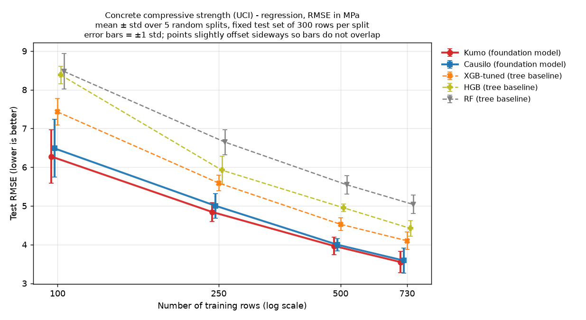
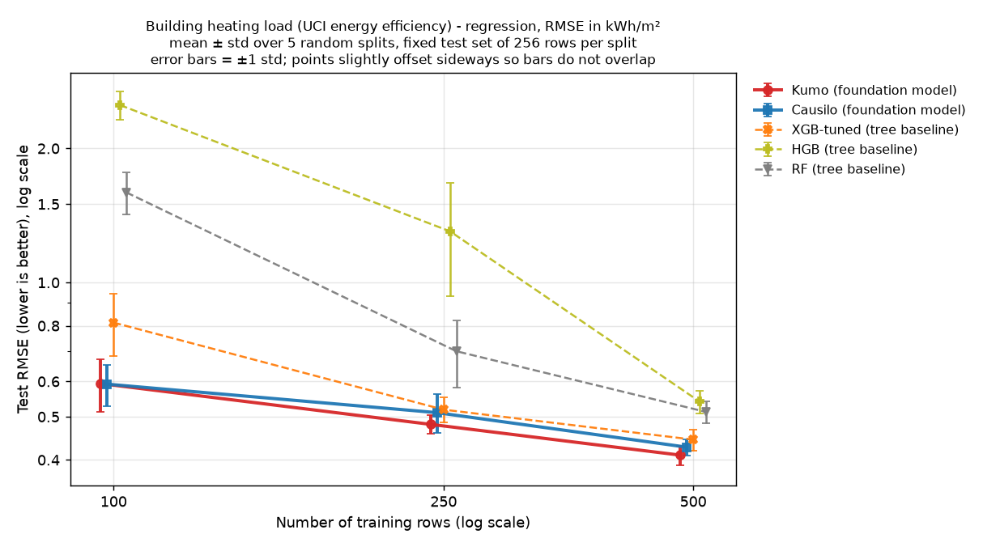
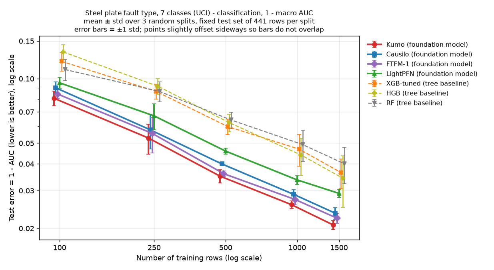
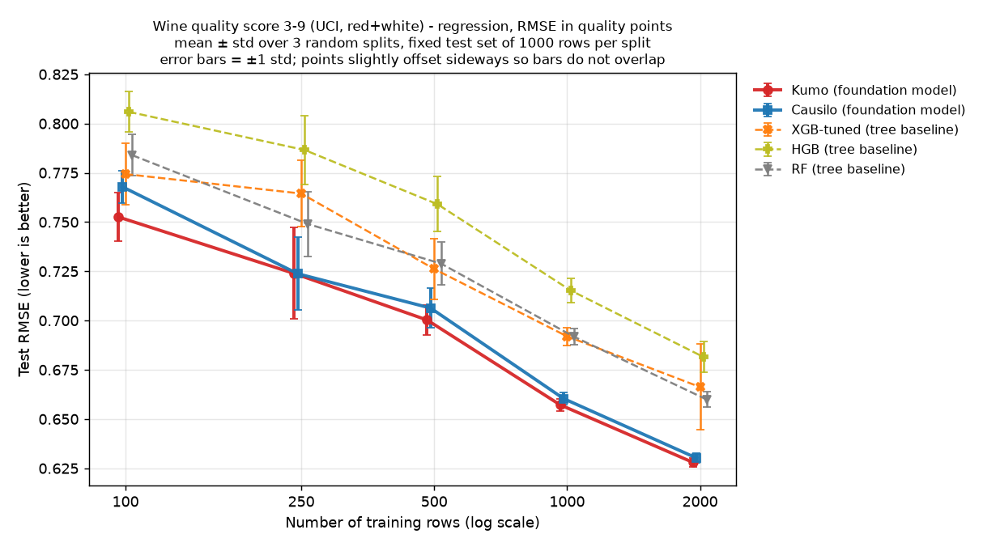
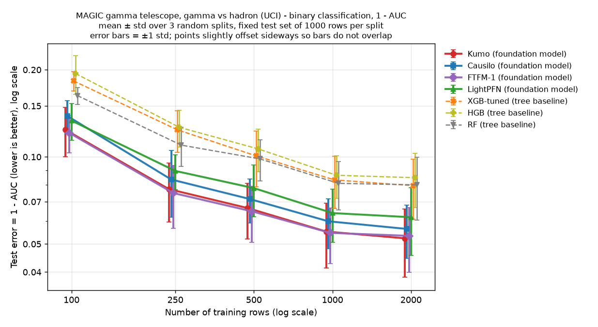
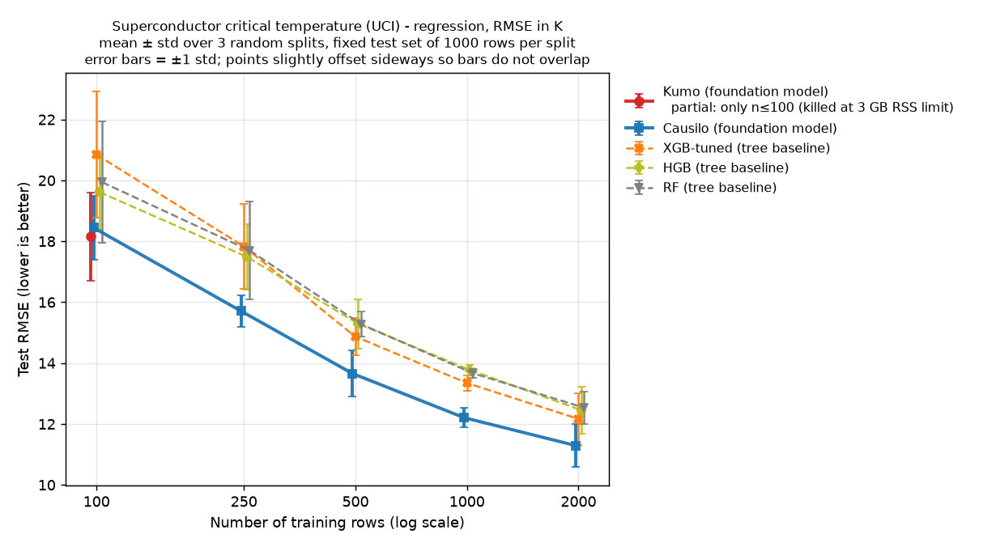

# 소형 표(tabular) 파운데이션 모델 vs 튜닝된 트리 모델 — 학습곡선 PoC

*2026-11-02(KST) 작성. 근거 파일은 `results/*.json`, `results/*_summary.csv`, `results/*_raw.csv`입니다. 아래 숫자는 모두 이 파일에서 그대로 옮겼거나 직접 계산한 값(비율, 분할별 승수)입니다.*

## 요약

- **공개 UCI 데이터셋 6개, 학습 100 ~ 2,000행으로 비교했습니다.** 6개 데이터셋의 모든 학습 크기에서 가장 좋은 파운데이션 모델(FM)의 평균 점수가 가장 좋은 트리 모델(RF, HGB, XGB-tuned 중 최고)보다 높았습니다. 최고 FM과 최고 트리 모두 평균 테스트 점수로 골랐습니다. 사후(post hoc) 비교이며, 보지 않은 데이터에서의 모델 선택 절차를 추정한 값이 아닙니다.
- **가장 큰 학습 크기에서의 개선폭:** concrete RMSE −13.4 %, energy_heating −7.7 %, wine_quality −4.8 %, superconduct −7.2 %. steel_faults는 (1 − AUC) −39.6 %, MagicTelescope는 −34.2 %입니다. AUC 차이로는 각각 +0.0136, +0.0272입니다.
- **데이터 효율(로그-n 보간 추정치, 실제 실행한 크기 아님):** 테스트 평균 순위가 가장 좋은 FM이 최고 트리 점수에 도달하는 행 수를 보간으로 추정했습니다. 트리/FM 학습 행 비율의 중앙값은 **1.97**, 즉 FM이 추정상 약 51 %의 행만 필요했습니다(보간 20개 지점, 범위 1.36 ~ 8.76). FTFM은 사전학습 데이터와 벤치마크의 중복이 일부 있다고 공개했으며, 여기서 쓴 두 분류 데이터셋이 해당되는지는 확인하지 못했습니다. 가장 큰 학습 크기 기준으로는 concrete 1.62배, energy_heating 1.40배, steel_faults 2.83배, wine_quality 2.09배, MagicTelescope 8.76배, superconduct 1.94배입니다.
- **Kumo(NVIDIA)** 는 6개 중 5개 데이터셋에서 가장 큰 학습 크기의 평균 1위였습니다. 예외인 superconduct에서는 Kumo가 메모리 한도로 종료되어 **Causilo** 만 전체 곡선을 냈습니다. MagicTelescope의 n ≤ 1000 구간은 **FTFM-1** 이 1위였습니다.
- **비용:** CPU에서 FM은 예측이 훨씬 느리고 메모리도 많이 씁니다. Kumo는 RSS 2.4 ~ 3.0 GB를 썼고, **superconduct(특성 81개)에서는 n = 250 도중 3 GB 한도로 강제 종료**되어 n = 100 결과만 있습니다. FTFM-1은 steel_faults n = 1500에서 분할당 학습에 158초가 걸렸습니다.
- **정확도보다 라이선스가 더 큰 변수입니다.** FTFM-1 가중치는 **CC BY-NC 4.0**, Causilo 가중치는 **비상업 "Causilo License v1.0"**, TabPFN-3.5 가중치도 비상업 라이선스입니다. TabPFN은 라이선스 동의와 계정이 필요해 돌리지 못했습니다. Kumo(가중치 OpenMDW-1.1, 코드 Apache-2.0)와 LightPFN(Apache-2.0, 분류 전용)은 각 조건에 따라 상업 이용이 가능합니다. 모델 가중치나 모델 출력물을 상업적으로 쓰기 전에는 체크포인트별 라이선스를 확인하세요.

## 1. 방법

| 항목 | 설정 |
|---|---|
| 하네스 | `bench_tabular.py`: 모델마다 별도 venv의 워커 프로세스로 실행하고, 오케스트레이터가 상태, 소요 시간, 최대 RSS를 기록 |
| 분할 | 반복 r(seed = r)마다 테스트셋 1개를 뽑고(분류는 층화), 나머지 풀에서 크기별 학습셋을 뽑음(분류는 층화). 한 반복 안에서는 모든 모델과 크기가 같은 테스트셋을 쓰고, 모든 모델이 같은 학습 행을 씀 |
| 반복 / 테스트 크기 | concrete 5회·300행, energy_heating 5회·256행(요청은 268행이었으나 N/3으로 제한), steel_faults 3회·441행, wine_quality·MagicTelescope·superconduct 3회·1000행 |
| 학습 크기 | 공통 100, 250, 500. 추가로 concrete 730, energy_heating 없음, steel_faults 1000·1500, 나머지 1000·2000 |
| 전처리 | 비수치 특성은 서수 인코딩, 결측 특성은 학습 분할의 중앙값으로 대체, 타깃 결측 행은 제거 |
| 지표 | 회귀는 RMSE(원자료에 MAE, R² 포함). 분류는 ROC-AUC(이진, steel_faults 7클래스는 macro OvR)이고 원자료에 정확도와 log-loss 포함. 표는 반복 평균 ± 표준편차. 반복마다 테스트셋이 달라지므로 표준편차에는 테스트셋 차이도 섞여 있음 |
| 트리 기준선 | RF는 트리 500개, HGB는 sklearn 기본값, XGB-tuned는 랜덤 서치 20개 설정을 학습 행만으로 3-fold CV |
| FM(패키지 기본값, 튜닝 없음) | Kumo-Tabular(NVIDIA `structured-data-models` 0.2.1, estimator 4개, 회귀는 예측 분위수 999개의 평균), Causilo 1.0.3(estimator 4개), FTFM-1 0.1.0(분류만, 회귀 가중치 미공개), LightPFN 1.1.0(분류만), TabPFN 9.2.0(시도만 함) |
| "최고 트리" / "최고 FM" | 둘 다 평균 테스트 점수로 선택(사후 비교). 보지 않은 데이터에서의 모델 선택 절차 추정이 아님 |
| CPU / 메모리 제한 | `taskset -c 2,3`(8코어 중 2코어), `nice -n 10`, 스레드 2개(OMP/MKL/OpenBLAS), RSS 3000 MB 초과 시 워커 강제 종료, 제한 시간 3600초(wine_quality·MagicTelescope·superconduct는 3000초). GPU 없이 CPU만 사용 |
| 데이터 효율 비율 | 트리 크기 n_t ÷ (그 크기의 최고 트리 점수에 FM이 도달하는 행 수). FM 평균 곡선을 로그-선형 보간해 구함(`make_headline.py`). 전체 곡선이 있는 FM 중 평균 순위 1위를 사용 |
| 분할별 승수 | 같은 (크기, 반복) 분할에서 FM이 세 트리 중 최고보다 나았는지를 셈. 한 반복 안에서는 테스트셋을 모든 크기가 공유하므로, 예를 들어 15회 비교는 서로 다른 테스트셋 3개에서 나온 것이며 독립이 아님 |

## 2. 데이터셋과 실행 상태

| 데이터셋 | 행 | 특성 | 과제 | 상태 |
|---|---|---|---|---|
| concrete | 1,030 | 8 | 회귀(MPa) | 완료 |
| energy_heating | 768 | 8 | 회귀(kWh/m²) | 완료 |
| steel_faults | 1,941 | 27 | 7클래스 분류 | 완료 |
| wine_quality | 6,497 | 12 | 회귀(품질 점수) | 완료 |
| MagicTelescope | 19,020 | 10 | 이진 분류 | 완료 |
| superconduct | 21,263 | 81 | 회귀(K) | **부분 완료**: Kumo가 n = 250 도중 RSS 3 GB 한도로 종료(최대 3,025 MB)되어 n = 100만 있음. 나머지 모델은 모두 완료 |

전 데이터셋 공통 모델 상태:
- **TabPFN:** 모두 실행 불가(`TabPFNLicenseError`, Prior Labs 계정으로 라이선스 동의 필요).
- **FTFM-1:** 회귀 4종에서 실행 불가(회귀 가중치 미공개).
- **LightPFN:** 회귀에서는 건너뜀(분류 전용).

## 3. 데이터셋별 결과

굵은 글씨는 해당 크기의 평균 1위입니다. 각 표 아래의 "FM vs tree"는 크기별로 최고 FM과 최고 트리를 비교한 값이고, 음수면 FM이 낫습니다. 차트는 `charts/learning_curve_<name>.png`에 있습니다. (표 머리글은 스크립트 출력 그대로 영어로 두었습니다.)

#### concrete  (1030 rows, 8 features, reg, test 300 rows, 5 repeats; metric RMSE mean ± std)

| Model | n=100 | n=250 | n=500 | n=730 |
|---|---|---|---|---|
| Kumo | **6.277 ± 0.693** | **4.842 ± 0.240** | **3.965 ± 0.225** | **3.550 ± 0.272** |
| Causilo | 6.487 ± 0.747 | 5.003 ± 0.315 | 3.998 ± 0.158 | 3.589 ± 0.322 |
| XGB-tuned (tree) | 7.428 ± 0.342 | 5.591 ± 0.201 | 4.525 ± 0.166 | 4.100 ± 0.228 |
| HGB (tree) | 8.381 ± 0.223 | 5.924 ± 0.363 | 4.950 ± 0.103 | 4.421 ± 0.202 |
| RF (tree) | 8.475 ± 0.459 | 6.648 ± 0.324 | 5.546 ± 0.236 | 5.038 ± 0.239 |

| n | best FM | best tree | FM vs tree |
|---|---|---|---|
| 100 | Kumo 6.277 | XGB-tuned 7.428 | -15.5 % RMSE |
| 250 | Kumo 4.842 | XGB-tuned 5.591 | -13.4 % RMSE |
| 500 | Kumo 3.965 | XGB-tuned 4.525 | -12.4 % RMSE |
| 730 | Kumo 3.55 | XGB-tuned 4.1 | -13.4 % RMSE |

Data efficiency (rows the FM needs to match the best tree at the largest size; log-interpolated):

- Causilo: tree XGB-tuned at n=730 scores 4.1; FM matches at n≈466.1 → ratio 1.57  
- Kumo: tree XGB-tuned at n=730 scores 4.1; FM matches at n≈449.4 → ratio 1.62  

Model status: RF: finished; HGB: finished; XGB-tuned: finished; Causilo: finished; LightPFN: skipped [classification-only model]; FTFM-1: unavailable (NotImplementedError: FTFMRegressor is not yet implemented: regression weights have not bee); Kumo: finished; TabPFN: unavailable (TabPFNLicenseError: TabPFN requires a one-time license acceptance to download)

분할별 승수: Kumo와 Causilo 모두 최고 트리 대비 20/20.

#### energy_heating  (768 rows, 8 features, reg, test 256 rows, 5 repeats; metric RMSE mean ± std)

| Model | n=100 | n=250 | n=500 |
|---|---|---|---|
| Kumo | 0.593 ± 0.080 | **0.481 ± 0.023** | **0.410 ± 0.021** |
| Causilo | **0.592 ± 0.063** | 0.511 ± 0.050 | 0.427 ± 0.018 |
| XGB-tuned (tree) | 0.813 ± 0.130 | 0.519 ± 0.033 | 0.444 ± 0.024 |
| HGB (tree) | 2.502 ± 0.184 | 1.303 ± 0.372 | 0.541 ± 0.032 |
| RF (tree) | 1.593 ± 0.174 | 0.701 ± 0.120 | 0.513 ± 0.029 |

| n | best FM | best tree | FM vs tree |
|---|---|---|---|
| 100 | Causilo 0.5916 | XGB-tuned 0.8131 | -27.2 % RMSE |
| 250 | Kumo 0.4807 | XGB-tuned 0.5186 | -7.3 % RMSE |
| 500 | Kumo 0.41 | XGB-tuned 0.4442 | -7.7 % RMSE |

Data efficiency (rows the FM needs to match the best tree at the largest size; log-interpolated):

- Causilo: tree XGB-tuned at n=500 scores 0.4442; FM matches at n≈434.1 → ratio 1.15  
- Kumo: tree XGB-tuned at n=500 scores 0.4442; FM matches at n≈357.5 → ratio 1.4  

Model status: RF: finished; HGB: finished; XGB-tuned: finished; Causilo: finished; LightPFN: skipped [classification-only model]; FTFM-1: unavailable (NotImplementedError: FTFMRegressor is not yet implemented: regression weights have not bee); Kumo: finished; TabPFN: unavailable (TabPFNLicenseError: TabPFN requires a one-time license acceptance to download)

분할별 승수: Kumo 14/15, Causilo 11/15. n = 100에서는 Kumo(0.593)와 Causilo(0.592)가 사실상 동률입니다. FM 우위가 가장 약한 데이터셋으로, n ≥ 250에서 XGB-tuned와의 차이가 7 ~ 8 %에 그칩니다. 작은 n에서는 HGB 성능이 특히 나빴습니다.

#### steel_faults  (1941 rows, 27 features, cls, test 441 rows, 3 repeats; metric AUC mean ± std)

| Model | n=100 | n=250 | n=500 | n=1000 | n=1500 |
|---|---|---|---|---|---|
| Kumo | **0.9189 ± 0.0065** | **0.9472 ± 0.0084** | **0.9649 ± 0.0024** | **0.9742 ± 0.0010** | **0.9793 ± 0.0010** |
| Causilo | 0.9094 ± 0.0059 | 0.9423 ± 0.0107 | 0.9600 ± 0.0003 | 0.9711 ± 0.0015 | 0.9765 ± 0.0015 |
| FTFM-1 | 0.9152 ± 0.0041 | 0.9445 ± 0.0106 | 0.9640 ± 0.0011 | 0.9727 ± 0.0015 | 0.9777 ± 0.0012 |
| LightPFN | 0.9043 ± 0.0057 | 0.9330 ± 0.0092 | 0.9541 ± 0.0015 | 0.9663 ± 0.0016 | 0.9709 ± 0.0013 |
| XGB-tuned (tree) | 0.8794 ± 0.0119 | 0.9127 ± 0.0069 | 0.9402 ± 0.0049 | 0.9531 ± 0.0079 | 0.9635 ± 0.0057 |
| HGB (tree) | 0.8668 ± 0.0107 | 0.9077 ± 0.0079 | 0.9377 ± 0.0058 | 0.9559 ± 0.0087 | 0.9657 ± 0.0093 |
| RF (tree) | 0.8896 ± 0.0126 | 0.9128 ± 0.0094 | 0.9359 ± 0.0056 | 0.9508 ± 0.0082 | 0.9600 ± 0.0077 |

| n | best FM | best tree | FM vs tree |
|---|---|---|---|
| 100 | Kumo 0.9189 | RF 0.8896 | -26.5 % (1−AUC) |
| 250 | Kumo 0.9472 | RF 0.9128 | -39.4 % (1−AUC) |
| 500 | Kumo 0.9649 | XGB-tuned 0.9402 | -41.4 % (1−AUC) |
| 1000 | Kumo 0.9742 | HGB 0.9559 | -41.5 % (1−AUC) |
| 1500 | Kumo 0.9793 | HGB 0.9657 | -39.6 % (1−AUC) |

Data efficiency (rows the FM needs to match the best tree at the largest size; log-interpolated):

- Causilo: tree HGB at n=1500 scores 0.9657; FM matches at n≈711.3 → ratio 2.11  
- FTFM-1: tree HGB at n=1500 scores 0.9657; FM matches at n≈570.4 → ratio 2.63  
- Kumo: tree HGB at n=1500 scores 0.9657; FM matches at n≈529.3 → ratio 2.83  
- LightPFN: tree HGB at n=1500 scores 0.9657; FM matches at n≈963.3 → ratio 1.56  

Model status: RF: finished; HGB: finished; XGB-tuned: finished; Causilo: finished; LightPFN: finished; FTFM-1: finished; Kumo: finished; TabPFN: unavailable (TabPFNLicenseError: TabPFN requires a one-time license acceptance to download)

분할별 승수: Kumo, Causilo, FTFM-1은 15/15, LightPFN은 14/15.

#### wine_quality  (6497 rows, 12 features, reg, test 1000 rows, 3 repeats; metric RMSE mean ± std)

| Model | n=100 | n=250 | n=500 | n=1000 | n=2000 |
|---|---|---|---|---|---|
| Kumo | **0.753 ± 0.012** | 0.724 ± 0.023 | **0.700 ± 0.007** | **0.657 ± 0.003** | **0.628 ± 0.002** |
| Causilo | 0.768 ± 0.008 | **0.724 ± 0.018** | 0.706 ± 0.010 | 0.660 ± 0.003 | 0.630 ± 0.002 |
| XGB-tuned (tree) | 0.774 ± 0.016 | 0.764 ± 0.017 | 0.726 ± 0.015 | 0.692 ± 0.005 | 0.666 ± 0.022 |
| HGB (tree) | 0.806 ± 0.010 | 0.787 ± 0.017 | 0.759 ± 0.014 | 0.715 ± 0.006 | 0.682 ± 0.008 |
| RF (tree) | 0.784 ± 0.011 | 0.749 ± 0.016 | 0.729 ± 0.011 | 0.692 ± 0.004 | 0.660 ± 0.004 |

| n | best FM | best tree | FM vs tree |
|---|---|---|---|
| 100 | Kumo 0.7526 | XGB-tuned 0.7743 | -2.8 % RMSE |
| 250 | Causilo 0.7238 | RF 0.749 | -3.4 % RMSE |
| 500 | Kumo 0.7003 | XGB-tuned 0.7262 | -3.6 % RMSE |
| 1000 | Kumo 0.6572 | RF 0.6918 | -5.0 % RMSE |
| 2000 | Kumo 0.628 | RF 0.6599 | -4.8 % RMSE |

Data efficiency (rows the FM needs to match the best tree at the largest size; log-interpolated):

- Causilo: tree RF at n=2000 scores 0.6599; FM matches at n≈1011.0 → ratio 1.98  
- Kumo: tree RF at n=2000 scores 0.6599; FM matches at n≈958.0 → ratio 2.09  

Model status: RF: finished; HGB: finished; XGB-tuned: finished; Causilo: finished; LightPFN: skipped [classification-only model]; FTFM-1: unavailable (NotImplementedError: FTFMRegressor is not yet implemented: regression weights have not bee); Kumo: finished; TabPFN: unavailable (TabPFNLicenseError: TabPFN requires a one-time license acceptance to download)

분할별 승수: Kumo 15/15, Causilo 14/15. 개선폭(RMSE 2.8 ~ 5.0 %)은 작지만 일관됩니다.

#### MagicTelescope  (19020 rows, 10 features, cls, test 1000 rows, 3 repeats; metric AUC mean ± std)

| Model | n=100 | n=250 | n=500 | n=1000 | n=2000 |
|---|---|---|---|---|---|
| Kumo | 0.8758 ± 0.0241 | 0.9226 ± 0.0178 | 0.9334 ± 0.0145 | 0.9448 ± 0.0139 | **0.9477 ± 0.0139** |
| Causilo | 0.8615 ± 0.0181 | 0.9165 ± 0.0217 | 0.9285 ± 0.0125 | 0.9401 ± 0.0117 | 0.9436 ± 0.0117 |
| FTFM-1 | **0.8791 ± 0.0177** | **0.9250 ± 0.0184** | **0.9352 ± 0.0143** | **0.9454 ± 0.0119** | 0.9466 ± 0.0135 |
| LightPFN | 0.8665 ± 0.0192 | 0.9106 ± 0.0124 | 0.9220 ± 0.0158 | 0.9360 ± 0.0134 | 0.9381 ± 0.0162 |
| XGB-tuned (tree) | 0.8169 ± 0.0143 | 0.8759 ± 0.0205 | 0.8991 ± 0.0220 | 0.9167 ± 0.0171 | 0.9205 ± 0.0186 |
| HGB (tree) | 0.8059 ± 0.0298 | 0.8735 ± 0.0183 | 0.8934 ± 0.0179 | 0.9136 ± 0.0145 | 0.9153 ± 0.0179 |
| RF (tree) | 0.8372 ± 0.0109 | 0.8902 ± 0.0170 | 0.9016 ± 0.0159 | 0.9190 ± 0.0153 | 0.9200 ± 0.0196 |

| n | best FM | best tree | FM vs tree |
|---|---|---|---|
| 100 | FTFM-1 0.8791 | RF 0.8372 | -25.7 % (1−AUC) |
| 250 | FTFM-1 0.925 | RF 0.8902 | -31.7 % (1−AUC) |
| 500 | FTFM-1 0.9352 | RF 0.9016 | -34.1 % (1−AUC) |
| 1000 | FTFM-1 0.9454 | RF 0.919 | -32.6 % (1−AUC) |
| 2000 | Kumo 0.9477 | XGB-tuned 0.9205 | -34.2 % (1−AUC) |

Data efficiency (rows the FM needs to match the best tree at the largest size; log-interpolated):

- Causilo: tree XGB-tuned at n=2000 scores 0.9205; FM matches at n≈315.1 → ratio 6.35  
- FTFM-1: tree XGB-tuned at n=2000 scores 0.9205; FM matches at n≈228.4 → ratio 8.76  
- Kumo: tree XGB-tuned at n=2000 scores 0.9205; FM matches at n≈239.6 → ratio 8.35  
- LightPFN: tree XGB-tuned at n=2000 scores 0.9205; FM matches at n≈455.5 → ratio 4.39  

Model status: RF: finished; HGB: finished; XGB-tuned: finished; Causilo: finished; LightPFN: finished; FTFM-1: finished; Kumo: finished; TabPFN: unavailable (TabPFNLicenseError: TabPFN requires a one-time license acceptance to download)

분할별 승수: FM 4종 모두 15/15. 반복마다 테스트셋이 달라 오차 막대는 겹쳐 보이지만, 같은 분할 안에서는 순위가 한 번도 뒤집히지 않았습니다.

#### superconduct  (21263 rows, 81 features, reg, test 1000 rows, 3 repeats; metric RMSE mean ± std)

| Model | n=100 | n=250 | n=500 | n=1000 | n=2000 |
|---|---|---|---|---|---|
| Kumo | **18.152 ± 1.445** | – | – | – | – |
| Causilo | 18.445 ± 1.054 | **15.708 ± 0.509** | **13.657 ± 0.763** | **12.208 ± 0.314** | **11.294 ± 0.697** |
| XGB-tuned (tree) | 20.845 ± 2.069 | 17.830 ± 1.401 | 14.867 ± 0.605 | 13.345 ± 0.250 | 12.167 ± 0.849 |
| HGB (tree) | 19.617 ± 1.235 | 17.492 ± 1.077 | 15.289 ± 0.808 | 13.776 ± 0.171 | 12.453 ± 0.774 |
| RF (tree) | 19.938 ± 1.997 | 17.698 ± 1.597 | 15.279 ± 0.420 | 13.670 ± 0.145 | 12.534 ± 0.532 |

| n | best FM | best tree | FM vs tree |
|---|---|---|---|
| 100 | Kumo 18.15 | HGB 19.62 | -7.5 % RMSE |
| 250 | Causilo 15.71 | HGB 17.49 | -10.2 % RMSE |
| 500 | Causilo 13.66 | XGB-tuned 14.87 | -8.1 % RMSE |
| 1000 | Causilo 12.21 | XGB-tuned 13.34 | -8.5 % RMSE |
| 2000 | Causilo 11.29 | XGB-tuned 12.17 | -7.2 % RMSE |

Data efficiency (rows the FM needs to match the best tree at the largest size; log-interpolated):

- Causilo: tree XGB-tuned at n=2000 scores 12.17; FM matches at n≈1032.1 → ratio 1.94  
- Kumo: tree HGB at n=100 scores 19.62; FM matches at n≈100.0 → ratio 1.0  FM already matches at the smallest size measured (100); ratio is a lower bound

Model status: RF: finished; HGB: finished; XGB-tuned: finished; Causilo: finished; LightPFN: skipped [classification-only model]; FTFM-1: unavailable (NotImplementedError: FTFMRegressor is not yet implemented: regression weights have not bee); Kumo: failed [killed: RSS 3025 MB > limit 3000 MB]; TabPFN: unavailable (TabPFNLicenseError: TabPFN requires a one-time license acceptance to download)

분할별 승수: Causilo 15/15, Kumo 3/3(n = 100만). 위 Kumo의 데이터 효율 항목(비율 1.0)은 측정 크기가 하나뿐이라 생긴 값이므로 무시해야 합니다.

## 4. 데이터 효율(헤드라인)

`make_headline.py` 출력(`results/headline.md`, `results/headline.json`):

| Dataset | Best FM | tree size n_t | best tree (score) | FM rows to match | data ratio |
|---|---|---|---|---|---|
| concrete | Kumo | 100 | XGB-tuned (7.428) | ≤ 100 | ≥ 1.00× |
| concrete | Kumo | 250 | XGB-tuned (5.591) | 155 | 1.61× |
| concrete | Kumo | 500 | XGB-tuned (4.525) | 321 | 1.56× |
| concrete | Kumo | 730 | XGB-tuned (4.1) | 449 | 1.62× |
| energy_heating | Kumo | 100 | XGB-tuned (0.8131) | ≤ 100 | ≥ 1.00× |
| energy_heating | Kumo | 250 | XGB-tuned (0.5186) | 184 | 1.36× |
| energy_heating | Kumo | 500 | XGB-tuned (0.4442) | 358 | 1.40× |
| steel_faults | Kumo | 100 | RF (0.8896) | ≤ 100 | ≥ 1.00× |
| steel_faults | Kumo | 250 | RF (0.9128) | ≤ 100 | ≥ 2.50× |
| steel_faults | Kumo | 500 | XGB-tuned (0.9402) | 199 | 2.51× |
| steel_faults | Kumo | 1000 | HGB (0.9559) | 352 | 2.84× |
| steel_faults | Kumo | 1500 | HGB (0.9657) | 529 | 2.83× |
| wine_quality | Kumo | 100 | XGB-tuned (0.7743) | ≤ 100 | ≥ 1.00× |
| wine_quality | Kumo | 250 | RF (0.749) | 112 | 2.23× |
| wine_quality | Kumo | 500 | XGB-tuned (0.7262) | 232 | 2.15× |
| wine_quality | Kumo | 1000 | RF (0.6918) | 573 | 1.75× |
| wine_quality | Kumo | 2000 | RF (0.6599) | 958 | 2.09× |
| MagicTelescope | FTFM-1 | 100 | RF (0.8372) | ≤ 100 | ≥ 1.00× |
| MagicTelescope | FTFM-1 | 250 | RF (0.8902) | 125 | 2.00× |
| MagicTelescope | FTFM-1 | 500 | RF (0.9016) | 157 | 3.19× |
| MagicTelescope | FTFM-1 | 1000 | RF (0.919) | 222 | 4.51× |
| MagicTelescope | FTFM-1 | 2000 | XGB-tuned (0.9205) | 228 | 8.76× |
| superconduct | Causilo | 100 | HGB (19.62) | ≤ 100 | ≥ 1.00× |
| superconduct | Causilo | 250 | HGB (17.49) | 138 | 1.82× |
| superconduct | Causilo | 500 | XGB-tuned (14.87) | 332 | 1.51× |
| superconduct | Causilo | 1000 | XGB-tuned (13.34) | 581 | 1.72× |
| superconduct | Causilo | 2000 | XGB-tuned (12.17) | 1032 | 1.94× |

Interpolated ratios: n=20, median 1.97×, min 1.36×, max 8.76×

## 5. 비용: 시간과 메모리(CPU 2코어)

가장 큰 학습 크기에서 분할당 평균 시간입니다(학습 + 예측, 초). 예측은 테스트셋 전체 기준입니다.

| 데이터셋 (n, 테스트) | RF | HGB | XGB-tuned | Kumo | Causilo | FTFM-1 | LightPFN |
|---|---|---|---|---|---|---|---|
| concrete (730, 300) | 0.7 + 0.1 | 0.1 + 0.0 | 9.3 + 0.0 | 0.4 + 9.4 | 0.1 + 2.2 | – | – |
| energy_heating (500, 256) | 0.3 + 0.1 | 0.1 + 0.0 | 4.1 + 0.0 | 0.3 + 6.3 | 0.1 + 1.4 | – | – |
| steel_faults (1500, 441) | 0.9 + 0.1 | 0.9 + 0.0 | 54.0 + 0.0 | 0.4 + 45.2 | 0.2 + 8.1 | 158.5 + 24.8 | 2.2 + 0.5 |
| wine_quality (2000, 1000) | 2.2 + 0.1 | 0.6 + 0.0 | 10.1 + 0.0 | 0.4 + 85.7 | 0.1 + 15.1 | – | – |
| MagicTelescope (2000, 1000) | 1.4 + 0.1 | 0.4 + 0.0 | 11.9 + 0.0 | 0.5 + 62.7 | 0.1 + 18.3 | 69.7 + 25.4 | 1.7 + 0.8 |
| superconduct (2000, 1000) | 12.8 + 0.1 | 0.4 + 0.0 | 65.9 + 0.0 | 강제 종료 | 0.5 + 64.1 | – | – |

워커 프로세스 트리의 최대 RSS(MB):

| 데이터셋 | RF | HGB | XGB-tuned | Kumo | Causilo | FTFM-1 | LightPFN |
|---|---|---|---|---|---|---|---|
| concrete | 191 | 154 | 184 | 2,460 | 617 | – | – |
| energy_heating | 190 | 153 | 174 | 2,405 | 627 | – | – |
| steel_faults | 217 | 160 | 224 | 2,989 | 946 | 2,641 | 456 |
| wine_quality | 209 | 157 | 207 | 2,614 | 1,078 | – | – |
| MagicTelescope | 200 | 158 | 178 | 2,654 | 1,007 | 2,713 | 437 |
| superconduct | 287 | 168 | 294 | 3,025 (종료) | 2,378 | – | – |

## 6. FM이 이기는 곳과 지는 곳

**이기는 곳**
- 작은 n에서의 정확도: 6개 데이터셋의 모든 크기에서 모든 FM의 평균이 모든 트리의 평균보다 좋았습니다. 상대 개선폭은 분류에서 가장 컸습니다(가장 큰 크기에서 FM 4종 기준 steel_faults와 MagicTelescope의 (1 − AUC) 15 ~ 40 % 감소, Kumo는 39.6 %와 34.2 %).
- 데이터 효율: 가장 큰 학습 크기 기준으로 최고 트리와 같은 점수를 내는 데 필요한 행이 보간 추정으로 5개 데이터셋에서 1.40 ~ 2.83배, MagicTelescope에서 8.76배 적었습니다.
- 튜닝 불필요: FM은 기본값으로 20개 설정 튜닝 XGBoost를 이겼습니다. 양쪽 모두 테스트 점수로 골랐습니다.

**지는 곳 / 주의점**
- 추론 비용: n = 2000에서 테스트 1,000행당 Kumo는 63 ~ 86초, Causilo는 15 ~ 64초가 걸렸고 트리는 최대 0.13초였습니다. Kumo와 Causilo는 시간 대부분을 예측에 썼고, FTFM-1은 steel_faults에서 학습에만 158초가 걸렸습니다. 더 큰 스크리닝 작업에서는 예측 시간이 제약이 될 수 있지만, 그런 작업은 시험하지 않았습니다.
- 메모리: Kumo는 2.4 ~ 3.0 GB로 3 GB 예산의 한계선에 있고, 특성이 가장 많은 superconduct(81개)에서는 n = 250에서 실패했습니다. Causilo도 superconduct에서 2.4 GB까지 올라갔습니다.
- 잡음이 큰 회귀에서는 차이가 작습니다. wine_quality는 2.8 ~ 5.0 %, energy_heating은 n ≥ 250에서 7 ~ 8 %입니다. Causilo는 energy_heating의 15개 분할 중 4개에서 최고 트리에 졌습니다.
- 지원 범위: FTFM-1과 LightPFN은 회귀를 못 하고, TabPFN은 평가하지 못했습니다.
- FM 간 차이: LightPFN은 가장 가볍지만(가장 큰 크기에서 분할당 2.5 ~ 2.8초, 약 440 ~ 460 MB) 분류 FM 4종 중 가장 약했습니다. 그래도 크기×반복 비교 30회 중 29회에서 최고 트리를 이겼습니다.

## 7. 라이선스(2026-11-01/02에 설치된 패키지 메타데이터와 Hugging Face 모델 카드로 확인)

| 모델 | 코드 라이선스 | 가중치 라이선스 | 상업적 사용 |
|---|---|---|---|
| Kumo-Tabular (NVIDIA, `structured-data-models` 0.2.1) | Apache-2.0 | OpenMDW-1.1 (HF `nvidia/Kumo-Tabular`) | 조건 준수 시 가능(가중치 재배포 시 라이선스 사본과 출처 고지 유지, 출력물에는 제한 없음) |
| Causilo 1.0.3 (Nums AI) | Apache-2.0 (PyPI 패키지) | **Causilo License v1.0** (HF `nums-ai/causilo`): 비상업 전용. 모델 *또는 그 출력물*의 상업·운영 사용과 호스팅/API 제공에는 별도 라이선스 필요 | 상업 라이선스 없이는 **불가** |
| FTFM-1 0.1.0 | Apache-2.0 | **CC BY-NC 4.0** (`LICENSE-WEIGHTS.md`, HF `josifgrabocka/ftfm`) | 서면 허가 없이는 **불가**(UTN, Josif Grabocka 교수) |
| LightPFN 1.1.0 | Apache-2.0 | Apache-2.0 (HF `ueuegio/LightPFN`) | 가능 |
| TabPFN 9.2.0 / TabPFN-3.5 가중치 (Prior Labs) | Apache-2.0 | **TabPFN-3.5 License v1.0**: 비상업·비운영 전용, 계정 필요 | 상업 라이선스 없이는 **불가**. 실행하지 않음 |
| RF / HGB (scikit-learn), XGBoost | BSD-3 / Apache-2.0 | – | 가능 |

시사점: 상업용 결과물에 바로 쓸 수 있는 FM은 Kumo(회귀·분류)와 LightPFN(분류)입니다. Causilo와 FTFM-1의 결과는 가능성을 보여 주지만, 운영 환경이나 고객 납품에 쓰려면 먼저 라이선스를 받아야 합니다.

## 8. 한계

- 공개 UCI 데이터셋 6개뿐이고, 대부분 수치형이며 특성 81개 이하, 학습 2,000행 이하입니다. 고객 데이터가 아니며, 범주형 위주·고카디널리티·시계열성 데이터와 1만 행 이상 규모는 시험하지 않았습니다.
- 공개 벤치마크 데이터가 일부 FM의 사전학습·튜닝 데이터에 포함됐을 가능성이 있지만 확인하지 않았습니다. FTFM 모델 카드는 이름 기반 제외 필터가 일부 벤치마크 표를 놓쳤다고 밝히지만 어떤 표인지는 적지 않았습니다.
- 반복은 3 ~ 5회뿐입니다. 표준편차에는 학습 표본 차이와 테스트셋 차이가 섞여 있습니다. 분할별 승수는 제시했지만 정식 유의성 검정은 하지 않았습니다.
- 기준선: XGB 튜닝은 20개 설정의 소규모 탐색이고, CatBoost·LightGBM과 특성 공학은 없습니다. FM은 패키지 기본값(Kumo·Causilo estimator 4개)으로 돌렸으므로 앙상블을 늘리면 속도와 정확도가 달라질 수 있습니다.
- 최고 트리와 최고 FM 모두 테스트 점수로 고른 사후 선택입니다. 결론은 시험한 세 트리 기준선(RF, HGB, 20개 설정 XGBoost)에 한정됩니다.
- CPU 2코어, 3 GB 상한이라는 조건에 한정된 결과입니다. Kumo의 superconduct 실패와 모든 시간 수치는 이 예산 기준이며, GPU나 더 큰 메모리 한도에서는 달라집니다.
- Kumo 회귀값은 예측 분위수 999개의 평균으로, 가능한 점추정 방식 중 하나입니다.

## 9. 파일

- 결과: `results/<name>.json`, `results/<name>_summary.csv`, `results/<name>_raw.csv`, `results/tables.md`, `results/headline.md`, `results/headline.json`
- 차트: `charts/learning_curve_{concrete,energy_heating,steel_faults,wine_quality,MagicTelescope,superconduct}.png`
- 스크립트: `bench_tabular.py`, `make_tables.py`, `make_headline.py`(전체 곡선이 있는 FM만 사용하도록 수정), `make_charts.py`(범례에 부분 곡선 표시 추가)
